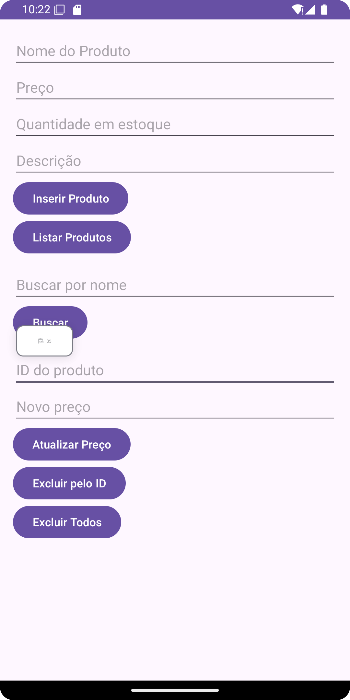
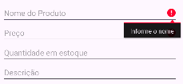
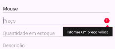
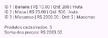
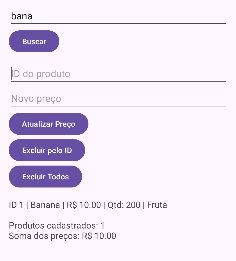
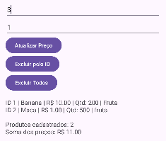
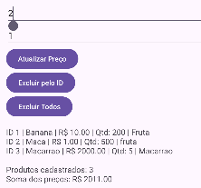
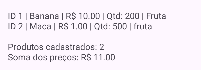

# AppRoomProduto: Cadastro de Produtos com Room SQLite

**Nome:** Diego Oliveira Gomes
**RA:** 243262

## Sobre o projeto

Aplicativo Android em Kotlin que cadastra, lista, busca, atualiza e exclui produtos usando persistência local com Room (SQLite).

## Tecnologias

- Kotlin
- Room 2.6.1 (SQLite)
- ViewBinding
- Corrotinas (lifecycleScope)

## Prints do app




---

## Parte A: Complemento prático

### A1. Limpar campos após inserir

**O que foi feito:** Depois que o produto é gravado com sucesso, os campos Nome, Preço, Quantidade e Descrição são limpos com `text.clear()` e o foco volta para o campo Nome com `requestFocus()`.

```kotlin
lifecycleScope.launch {
    productDao.insertAll(product)
    Toast.makeText(this@MainActivity, "Produto inserido!", Toast.LENGTH_SHORT).show()

    binding.editProductName.text.clear()
    binding.editProductPrice.text.clear()
    binding.editProductQuantity.text.clear()
    binding.editProductDescription.text.clear()
    binding.editProductName.requestFocus()
}
```

Print: 

### A2. Validação de preço

**O que foi feito:** O texto do preço é convertido com `toDoubleOrNull()`. Se estiver vazio, não for número ou for menor ou igual a zero, o erro aparece no próprio campo e o produto não é salvo.

```kotlin
val price = priceText.toDoubleOrNull()
if (price == null || price <= 0.0) {
    binding.editProductPrice.error = "Informe um preço válido"
    return@setOnClickListener
}
```

Print: 

### A3. Lista na tela

**O que foi feito:** Adicionei um `TextView` (`txtResultado`) abaixo dos botões. Ao clicar em Listar Produtos, a função `mostrarProdutos()` monta o texto com um produto por linha e o exibe na tela (e também no Logcat).

```kotlin
private fun mostrarProdutos(products: List<Product>) {
    val sb = StringBuilder()
    products.forEach {
        sb.appendLine("ID ${it.id} | ${it.name} | R$ ${String.format(Locale.US, "%.2f", it.price)} | Qtd: ${it.quantity} | ${it.description}")
    }
    binding.txtResultado.text = sb.toString()
}
```

Print: 

### A4. Total do estoque

**O que foi feito:** Junto da lista, a tela mostra a quantidade de produtos (`products.size`) e a soma dos preços (`products.sumOf { it.price }`).

```kotlin
val total = products.sumOf { it.price }
sb.appendLine("Produtos cadastrados: ${products.size}")
sb.append("Soma dos preços: R$ ${String.format(Locale.US, "%.2f", total)}")
```

Print: 

### A5. Buscar por nome

**O que foi feito:** Criei no DAO a consulta `buscarPorNome`, um campo de busca e o botão Buscar. O texto digitado é envolvido por `%` para encontrar nomes parecidos.

```kotlin
// ProductDao
@Query("SELECT * FROM product WHERE name LIKE :nome")
suspend fun buscarPorNome(nome: String): List<Product>

// MainActivity
binding.btnBuscar.setOnClickListener {
    val texto = binding.editBusca.text.toString().trim()
    lifecycleScope.launch {
        mostrarProdutos(productDao.buscarPorNome("%$texto%"))
    }
}
```

Print: 

### A6. Excluir produtos

**O que foi feito:** Criei `deleteAll()` e o botão Excluir Todos. Como desafio extra, criei também `deleteById()` e o botão Excluir pelo ID, que apaga um produto específico (o ID é digitado no campo de ID).

```kotlin
// ProductDao
@Query("DELETE FROM product")
suspend fun deleteAll()

@Query("DELETE FROM product WHERE id = :id")
suspend fun deleteById(id: Int): Int

@Delete
suspend fun delete(product: Product)
```

Print: 

### A7. Atualizar produto

**O que foi feito:** O usuário informa o ID e o novo preço. O app busca o produto com `getById`, cria uma cópia com o preço novo (`copy(price = novoPreco)`) e grava com `@Update`.

```kotlin
// ProductDao
@Update
suspend fun update(product: Product)

// MainActivity
val produto = productDao.getById(id)
if (produto != null) {
    productDao.update(produto.copy(price = novoPreco))
}
```

Print: 

### A8. Novo campo na tabela (quantity)

**O que foi feito:** Adicionei `quantity: Int` na entidade `Product`, um campo no layout e aumentei `version` para 2 no `@Database`.

```kotlin
@Entity
data class Product(
    @PrimaryKey(autoGenerate = true) val id: Int = 0,
    @ColumnInfo(name = "name") val name: String,
    @ColumnInfo(name = "price") val price: Double,
    @ColumnInfo(name = "description") val description: String?,
    @ColumnInfo(name = "quantity") val quantity: Int = 0
)

@Database(entities = [Product::class], version = 2)
abstract class AppDatabase : RoomDatabase() { ... }
```

**O que aconteceu com os produtos já cadastrados e por quê:** Como o banco foi criado com `fallbackToDestructiveMigration()`, ao detectar que a versão passou de 1 para 2 o Room apagou o banco antigo e criou outro do zero com a nova estrutura. Por isso os produtos cadastrados antes da mudança foram perdidos. Sem esse método e sem uma `Migration` definida, o app fecharia com erro, pois o Room não sabe sozinho como converter a tabela antiga na nova.

Print: 

---

## Parte B: Questões dissertativas

### B1. O que é persistência de dados? O que aconteceria se os produtos ficassem só em uma MutableList na MainActivity?

**Resposta:** Persistência de dados é a capacidade de guardar informações de forma que elas continuem existindo depois que o programa é fechado, o celular é reiniciado ou a tela é recriada. Os dados saem da memória temporária (RAM) e vão para um armazenamento permanente, como o arquivo do banco SQLite no próprio aparelho. No meu projeto, o Room grava cada `Product` nesse arquivo, e por isso consigo fechar o app, abrir de novo, clicar em Listar Produtos e ver tudo lá.

Se os produtos estivessem apenas em uma `MutableList` dentro da `MainActivity`, eles viveriam só na memória do processo. Ao fechar o app, o sistema destruiria a Activity e a lista seria perdida. Pior: até uma simples rotação de tela recria a Activity e esvazia a lista, a menos que o estado seja salvo à parte. O usuário cadastraria vários produtos e, na próxima abertura, não encontraria nenhum. Para qualquer app que precisa lembrar de informações, a lista em memória não serve, e por isso usamos banco de dados.

### B2. Diferença entre SQLite direto (SQLiteOpenHelper) e Room. Duas vantagens do Room.

**Resposta:** Com o SQLite direto, o programador escreve à mão os comandos SQL de criação de tabela (`CREATE TABLE`), manipula `Cursor` para ler os resultados e converte cada coluna para os atributos do objeto, tudo em strings sem verificação do compilador. É muito código repetitivo, e um erro de digitação em um nome de coluna só aparece quando o app roda e quebra. Já o Room é uma camada por cima do SQLite: eu declaro a entidade, o DAO e o banco com anotações, e ele gera o código necessário durante a compilação.

Vantagens do Room: (1) verificação das consultas em tempo de compilação, pois se eu errar o nome da tabela ou da coluna em um `@Query`, o build já acusa o erro, em vez de o app fechar na execução; (2) menos código repetitivo, já que `@Insert`, `@Update` e `@Delete` geram o SQL sozinhos e o resultado de um `SELECT` já volta como `List<Product>`, sem lidar com `Cursor`. Além disso, o Room tem integração com corrotinas (`suspend`) e com outros componentes do Jetpack.

### B3. Papel de Entity, DAO e Database e como se relacionam no projeto.

**Resposta:** A Entity (`Product`) é a classe que representa a tabela: cada atributo vira uma coluna e cada objeto criado é uma linha. Ela define o formato dos dados, com chave primária `id` autogerada e as colunas `name`, `price`, `description` e `quantity`. O DAO (`ProductDao`) é a interface onde descrevo as operações que quero fazer nessa tabela, como `getAll()`, `insertAll()`, `buscarPorNome()`, `update()` e `deleteAll()`. Eu só declaro as funções com anotações e o Room escreve a implementação.

O Database (`AppDatabase`) é a classe que reúne tudo: ela lista as entidades em `entities = [Product::class]`, define a versão do banco e expõe o DAO pela função abstrata `productDao()`. Na `MainActivity`, uso `Room.databaseBuilder` para criar o banco a partir do `AppDatabase`, peço o DAO com `db.productDao()` e, com ele, insiro e consulto objetos `Product`. Ou seja: o Database cria o arquivo e dá acesso ao DAO, o DAO executa as operações e a Entity define o que é guardado.

### B4. Por que não acessar o banco na thread principal? O que é ANR? Como suspend e lifecycleScope.launch resolvem?

**Resposta:** A thread principal (UI thread) é a responsável por desenhar a tela e responder aos toques do usuário. Acessar o banco de dados é uma operação de disco, que pode demorar, principalmente com muitos dados ou em aparelhos lentos. Se essa operação rodar na thread principal, a tela fica congelada esperando, e o usuário percebe travamentos. Por isso o Room bloqueia consultas na thread principal e lança o erro "Cannot access database on the main thread".

ANR (Application Not Responding) é o aviso que o Android mostra quando o app fica sem responder por tempo demais (cerca de 5 segundos para eventos de entrada), oferecendo ao usuário fechar o app ou esperar. No projeto, as funções do DAO são `suspend`, o que permite ao Room executá-las fora da thread principal e suspender a corrotina enquanto espera, sem bloquear a tela. O `lifecycleScope.launch { }` abre essa corrotina ligada ao ciclo de vida da Activity: o trabalho acontece em segundo plano, o resultado volta para atualizar a interface e, se a Activity for fechada, a corrotina é cancelada automaticamente, evitando vazamentos e erros.

### B5. O que faz o fallbackToDestructiveMigration()? Por que é perigoso na Play Store? O que é uma Migration?

**Resposta:** O `fallbackToDestructiveMigration()` diz ao Room o que fazer quando a versão do banco muda e não existe uma migração definida: em vez de dar erro, ele apaga o banco antigo, com todas as tabelas e dados, e cria um novo vazio com a estrutura atual. Foi o que aconteceu no item A8, quando os produtos cadastrados sumiram ao passar da versão 1 para a 2.

Em um app publicado, isso é perigoso porque cada atualização que mude a estrutura do banco faria os usuários perderem todos os seus dados, como produtos, registros e históricos, sem aviso. Seria uma péssima experiência e poderia causar prejuízo real. Uma Migration é um código que ensina o Room a passar de uma versão do banco para outra preservando os dados, normalmente executando comandos SQL, como `ALTER TABLE product ADD COLUMN quantity INTEGER NOT NULL DEFAULT 0`. Ela é registrada com `.addMigrations(...)` no `databaseBuilder`. Por isso, só devo usar a migração destrutiva durante o desenvolvimento.

### B6. Vantagem do ViewBinding sobre findViewById. Que erro ele evita?

**Resposta:** Com `findViewById`, preciso buscar cada componente da tela pelo id e fazer a conversão para o tipo certo, o que gera muito código repetido. O ViewBinding gera automaticamente uma classe (`ActivityMainBinding`) com uma propriedade para cada componente do layout, e eu acesso tudo direto, como `binding.editProductName` ou `binding.btnInserirProduto`, com o tipo já correto.

O principal erro que ele ajuda a evitar é o de tentar acessar um id que não existe ou usar o componente com o tipo errado, que no `findViewById` só aparece em tempo de execução, com `NullPointerException` ou `ClassCastException`. Com ViewBinding, esses problemas viram erros de compilação, então o app nem chega a rodar com o erro. Ele também é seguro contra nulos para componentes que existem no layout, e o código fica mais curto e legível.

### B7. Por que criar o banco como Singleton em apps maiores? O que poderia acontecer se várias telas criassem seu próprio banco?

**Resposta:** Criar uma instância do banco é uma operação pesada, pois envolve abrir o arquivo, verificar a versão e montar toda a estrutura interna. Em um app maior, com várias telas, o recomendado é ter uma única instância (Singleton) para o app inteiro, criada uma vez e reutilizada por todas as Activities e Fragments. Assim economizamos memória e processamento e há um único ponto de acesso aos dados.

Se cada tela criasse o seu próprio banco, teríamos várias conexões abertas ao mesmo arquivo, com mais consumo de memória e risco de conflitos e travamentos de escrita (como o erro de banco bloqueado). Também poderiam ocorrer inconsistências, como uma tela não perceber mudanças feitas por outra, e ficaria difícil manter e testar o código. Com o Singleton, normalmente implementado com um `companion object` e `@Volatile` na `AppDatabase` (ou com injeção de dependência), todas as telas compartilham a mesma conexão.

### B8. Reflexão pessoal

**Resposta:** *A principal dificuldade foi um erro de compilação logo na primeira execução, na tarefa checkDebugAarMetadata. A mensagem dizia que a biblioteca androidx.activity:activity:1.10.1 exigia compilar contra a versão 36 do Android, mas o meu projeto estava com compileSdk = 34 (e o plugin do Android, AGP 8.5.1, recomendava no máximo 34). Entendi que o problema não era o meu código, e sim a versão do projeto em relação às bibliotecas. Resolvi mudando o compileSdk para 36 no build.gradle.kts (Module :app), adicionando android.suppressUnsupportedCompileSdk=36 no gradle.properties e sincronizando o Gradle de novo.*

Um app real em que a persistência local com Room seria muito útil é um aplicativo de controle de estoque para uma pequena loja. O dono poderia cadastrar produtos com nome, preço, quantidade e descrição, tudo salvo no próprio celular, funcionando mesmo sem internet. Eu usaria uma entidade `Product`, como neste projeto, uma entidade `Venda` ligada aos produtos e um DAO com consultas como produtos com estoque baixo, busca por nome e total vendido no dia. Também daria para usar a base local como cache e sincronizar com um servidor quando houvesse conexão.

---

## Como executar

1. Clone o repositório
2. Abra no Android Studio
3. Execute em um emulador (API 24+)
